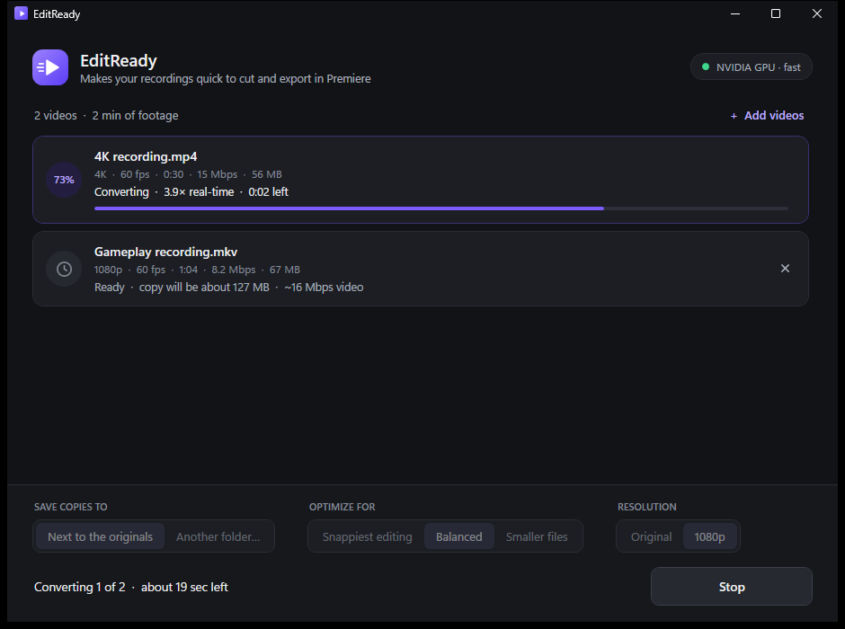
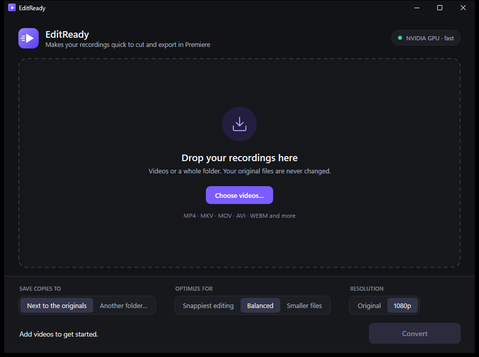
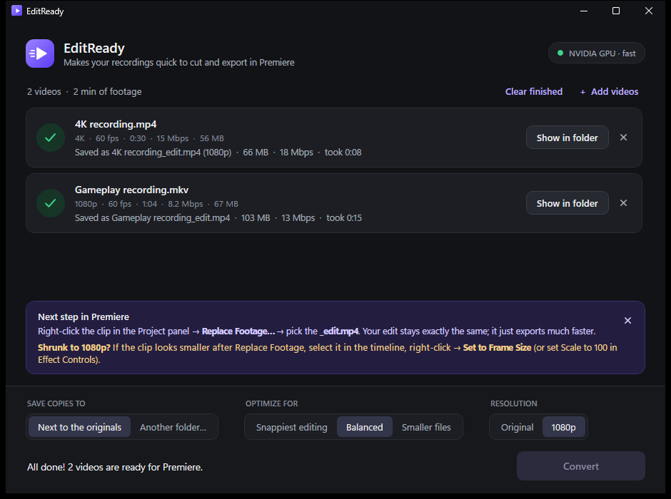

<p align="center">
  
</p>

<h1 align="center">EditReady</h1>

<p align="center">
  <b>Make your recordings quick to cut and export in Premiere Pro.</b><br>
  Drag a video in, get an <code>_edit.mp4</code> copy that Premiere can jump around in instantly.
</p>

<p align="center">
  <a href="https://github.com/APROYX/EditReady/releases/latest"><b>⬇ Download EditReady.exe</b></a>
  &nbsp;·&nbsp; Windows 10 / 11 &nbsp;·&nbsp; free &amp; open source (MIT)
</p>

<p align="center">
  
</p>

---

## The problem

You record with OBS, edit a fast-cut video in Premiere with hundreds of cuts… and the export takes **an hour**.
Your GPU isn't busy *encoding* the video. It's stuck *decoding* your source clips over and over.

In the export that started this project, the GPU's video **decoder sat at 84%** while its **encoder idled at 1–4%**.
Premiere was spending almost all of its time reading the source files, not writing the new one.

## Why it happens (the flipbook version)

A video is like a giant flipbook. To save space, recordings don't draw every page in full.
They draw one **full picture** (a *keyframe*) every few seconds, and every page in between is just a note:
"*this bit moved a little to the left*".

OBS recordings usually have a full picture only every **2–4 seconds**. At 60 fps that's up to ~240 pages of notes in between.

When Premiere needs a frame in the middle, it has to go back to the last full picture and apply every note up to that frame.
A fast-cut edit has a cut every second or two, so Premiere does that hundreds of times per export.

**EditReady redraws the flipbook with a full picture every 10 frames.** Now the nearest full picture is always right there,
and jumping to any frame is almost instant. That makes exports, timeline scrubbing and playback much faster.

> **Why not just remux in OBS?** A remux (MKV → MP4) only moves the same flipbook into a different box.
> It helps a little because Premiere reads MP4 better than MKV, but the keyframes stay exactly where they were.
> To change them, the video has to be re-encoded, and that's what EditReady does.

## How to use it

1. **Download** `EditReady.exe` from the [latest release](https://github.com/APROYX/EditReady/releases/latest). There's nothing to install.
2. **Drag your videos in.** You can also drag a whole folder, use *Choose videos…*, or drop files right onto `EditReady.exe`.
3. **Press Convert.** Each video gets a copy named `yourvideo_edit.mp4`, saved next to the original by default.
4. **In Premiere**, right-click the clip in the **Project panel** → **Replace Footage…** → pick the `_edit.mp4`.
   Your edit stays exactly the same; every cut stays in place, because the copy is frame-for-frame the same length.
5. **Export** as usual.

Your original files are never changed.

| Empty | Converting | Done |
|---|---|---|
|  |  |  |

## Options

**Save copies to**
- **Next to the originals** (default): each copy goes in the same folder as its video.
- **Another folder…**: all copies go in one folder, e.g. on a drive with more free space.

**Optimize for**

| Option | Full picture every | Bitrate cap | Best for |
|---|---|---|---|
| Snappiest editing | 5 frames | 3× the original's | Very fast cutting and scrubbing. Biggest files. |
| **Balanced** (default) | 10 frames | 2× the original's | Fast cuts and exports at a sensible size. |
| Smaller files | 30 frames | 1.4× the original's | Saving disk space. Still far quicker than a raw OBS recording. |

**Resolution**
- **Original** (default): every video keeps its resolution.
- **1080p**: 4K and 1440p videos are shrunk to 1080p. They convert about **3× faster**, the files are smaller,
  and editing is smoother. Videos that are already 1080p or smaller are left as they are; nothing is ever enlarged.
  Pick this when you export in 1080p anyway.

> **After replacing a 4K clip with a 1080p copy**, Premiere keeps the clip's old Scale. If it looks smaller in the frame,
> select it in the timeline, right-click → **Set to Frame Size** (or set **Scale** to 100 in Effect Controls).
> EditReady reminds you of this after a 1080p conversion.

Example: an 18-minute 4K60 video that is 2 GB (15 Mbps):

| | Original resolution | 1080p |
|---|---|---|
| Snappiest editing | ~5.8 GB | ~3.5 GB |
| **Balanced** | **~3.9 GB** | **~2.4 GB** |
| Smaller files | ~3.0 GB | ~1.7 GB |

## Features

- **Uses your NVIDIA GPU** (NVENC) for about 4× real-time on an RTX 2060: a 20-minute 1080p60 recording converts in about 5 minutes.
  Without an NVIDIA GPU, or if a file won't convert on the GPU, it switches to the CPU automatically.
- **Keeps every audio track** (game, mic, Discord… OBS multi-track recordings) untouched. AAC/MP3 audio is copied as-is;
  other formats (FLAC, Opus, PCM) become AAC 320 kbps, because Premiere doesn't read FLAC.
- **High quality without wasted space:** the copy is encoded at constant quality 16, capped at a multiple of the
  original's own bitrate, because a copy can't be sharper than its source. Spending more only makes the file bigger.
- **Optional 1080p downscale** for 4K / 1440p footage: about 3× faster to convert, smaller files, smoother editing.
- **Shows bitrates:** each card shows the original's video bitrate, the bitrate its copy will get, and the finished copy's
  measured bitrate, so you can see exactly where the size comes from.
- **Checks disk space first:** each card shows how big its copy will be, and EditReady warns you if a drive is too full.
- **Easy to follow:** percent, speed and time left for each video, an overall time left, and progress on the taskbar icon.
- **Safe:**
  - never overwrites anything (a second copy becomes `_edit (2).mp4`)
  - half-finished files are cleaned up if you press Stop
  - your PC won't go to sleep while converting
- Plays a sound and flashes the taskbar when it's done. Remembers your settings. **Ctrl+O** adds videos.
- **Command line:** `EditReady.exe [--queue] [--cpu] files-or-folders…`. Files given this way start right away;
  `--queue` only adds them to the list (handy for a *Send to* shortcut). `--cpu` skips the GPU.

## Requirements

- **Windows 10 or 11.** EditReady uses .NET Framework 4.8, which is already part of Windows.
- **ffmpeg.** If you don't have it, run this in a terminal:
  ```
  winget install Gyan.FFmpeg
  ```
  EditReady finds it automatically: on your PATH, in the winget folder, or next to `EditReady.exe`.
  If it still can't find it, it asks you to point to `ffmpeg.exe` once.
- **Optional: an NVIDIA graphics card** for the fast GPU mode. Everything also works on the CPU, just slower.

> **"Windows protected your PC"?** The exe isn't code-signed (signing certificates cost money), so SmartScreen may warn you the first time.
> Click **More info → Run anyway**. If you'd rather not trust a downloaded exe, [build it yourself](#build-from-source); it takes one command.

## Tip: fix it at the source

You can make future recordings edit-friendly straight away. In **OBS → Settings → Output → Recording**, set
**Keyframe Interval** to **1 s** (it's often on *auto*, which gives 2–4 s), and record to **MP4** or **Hybrid MP4**
instead of MKV. New recordings will then cut and export quickly without any converting.

## FAQ

**Does it lower the quality?**
Not in a way you'll see. Copies use constant quality 16 (H.264), capped at 2× the original's bitrate on Balanced.
Measured against the originals (SSIM, where 1.0 is identical), a 10 Mbps 1080p60 OBS recording scored 0.993,
and a 15 Mbps 4K60 recording scored 0.982 at 4K. Without the cap, the 4K file would have been 5× bigger for a score of 0.987.

**How big are the copies?**
About 1.5–2.5× the original on Balanced. That's the price of more full pictures.
For example, 20 minutes of 10 Mbps 1080p60 makes a ~2.3 GB copy. Delete the `_edit.mp4` files once your video is published.

**Is it only for Premiere?**
No. Any editor that struggles with long-GOP footage benefits, including DaVinci Resolve, Vegas and After Effects.
The *Replace Footage* step is just Premiere's way to swap clips.

**Does it work with AMD or Intel GPUs?**
Right now the fast mode is NVIDIA-only, and AMD/Intel PCs use the CPU mode (still faster than real time on most machines).
Pull requests for AMF / Quick Sync are welcome.

**A video failed. What now?**
Click **Details** on its card to see what ffmpeg reported, then **Retry**. If it keeps failing, please
[open an issue](https://github.com/APROYX/EditReady/issues) and include that text.

## What it runs under the hood

For each video, EditReady runs roughly:

```
ffmpeg -hwaccel cuda -i input.mkv -map 0:V:0 -map 0:a? [-vf scale=-2:1080:flags=bicubic] \
  -c:v h264_nvenc -preset p5 -rc vbr -cq 16 -b:v <0.85 × cap>M \
  -maxrate <cap>M -bufsize <2 × cap>M -profile:v high \
  -g 10 -keyint_min 10 -bf 0 -pix_fmt yuv420p \
  -c:a copy -map_metadata 0 input_edit.mp4
```

- `-g 10 -bf 0` gives a full picture every 10 frames and no B-frames, so every frame is cheap to reach.
- **cap** = the original's video bitrate × 3 / 2 / 1.4 (Snappiest / Balanced / Smaller).
  - When shrinking to 1080p, the source bitrate counts at 60% first.
  - Never below 10 Mbps at 1080p60 (scaled gently for other sizes), so low-bitrate sources don't get starved.
  - Never above 80 Mbps at 1080p60 (scaled with resolution and frame rate).
- CPU fallback: `-c:v libx264 -preset veryfast -crf 16` with the same cap and keyframe settings.
- The copy is written as `*.converting.mp4` and renamed only when finished, so a half-done file never looks finished.

## Build from source

You don't need Visual Studio or any SDK. Windows already includes the C# compiler.

```powershell
git clone https://github.com/APROYX/EditReady.git
cd EditReady
powershell -ExecutionPolicy Bypass -File .\build.ps1
```

That produces `EditReady.exe` next to the script (or use `.\build.ps1 -Out dist\EditReady.exe`).

| File | What it is |
|---|---|
| `EditReady.cs` | The app: queue, ffmpeg runner, progress, settings |
| `MainWindow.xaml` | The whole look of the window (WPF), loaded at runtime, so you can restyle it without touching the code |
| `build.ps1` | One-command build using the Windows C# compiler |
| `gen_icon.ps1` | Draws `EditReady.ico` |

## License

[MIT](LICENSE): free to use, change and share.
